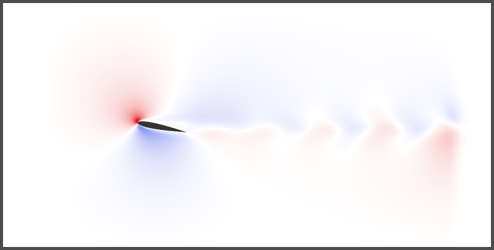
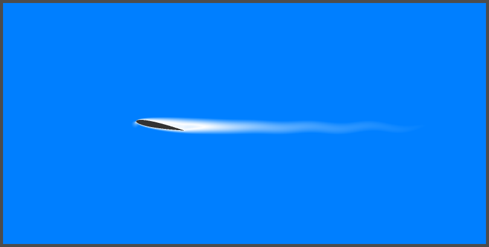
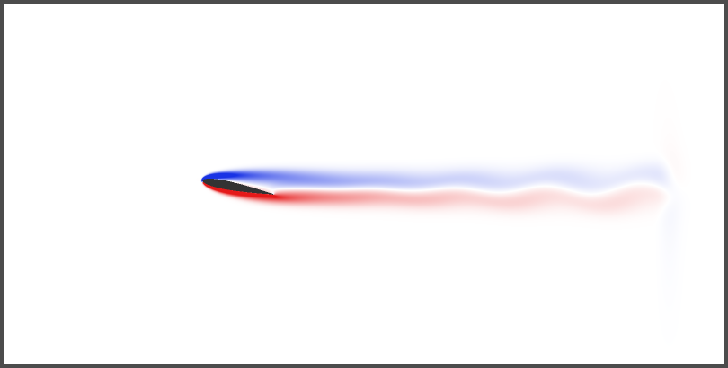
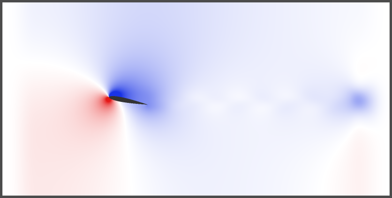

::: {.text-center}
{width="70%"}
:::

## Introduction
I built a real-time simulation of a wind tunnel featuring a NACA 0012 airfoil using the Lattice Boltzmann Method (LBM) in Godot 4.2. 
The main goal of this project was to understand how to implement the LBM from scratch and how to parallelize it. 
Because I wanted a real-time simulation—both for the challenge and for the pedagogical value of seeing the physics instantly, I chose Godot 4.2, which makes handling the graphical interface, compute shaders, and rendering very accessible.

## The Lattice Boltzmann Method
The LBM is a numerical method used to simulate fluids based on the Boltzmann equation, which links the microscopic and macroscopic behaviors of fluids. It uses uniform grids (lattices) to predict fluid motion through two main steps:

**1. Advection:** At each lattice cell, fluid particles move to neighboring cells following a discrete set of velocities, acting as a transport equation.  
**2. Collision:** The advected particles then undergo collisions, relaxing toward their local equilibrium state based on a specific collision operator.

## My Simulation

### Boundary Conditions

*   **Inlet:** Used the Zou-He velocity boundary condition to generate the incoming airflow. This method effectively determines the unknown distribution functions at the boundary when Dirichlet conditions are required.
*   **Outlet:** Applied a zero-gradient (Neumann) boundary condition to allow the fluid to exit smoothly.
*   **Sponge Zones:** Placed a small sponge zone at the inlet and a larger one at the outlet to absorb acoustic waves, relaxing the fluid back to the inlet velocity and base density.
*   **Top/Bottom Walls:** Implemented a free-slip (mirror) boundary condition. Particles heading for the wall bounce back symmetrically, conserving their tangential momentum so no artificial friction is induced.
*   **Airfoil:** Used a standard bounce-back (no-slip) boundary condition. Particles bounce back in the opposite direction, creating friction, which in turn generates drag and lift.

### Collision Operator
I initially started with a standard single-relaxation-time (BGK) operator but quickly upgraded to a Two-Relaxation-Time (**TRT**) operator due to early convergence issues. This switch significantly improved the simulation's stability.

### Parallel Computing
The physics engine uses the standard **D2Q9** lattice model and is entirely written in GLSL, running on my RTX 3060. By utilizing compute shaders, I mapped one lattice cell to one GPU thread. I structured the memory using two Structure of Arrays (SoA) buffers of size $9 \times N$ to store the current and next-step distribution functions. 
Running on a $1600 \times 800$ grid with a time sub-stepping of 35 (computing 35 physics steps before rendering the next frame), the simulation achieves a smooth ~105 physical frames per second.

### Visualization
I implemented several real-time visualization modes for the domain:

*   **Vertical Velocity:** $U_y$
*   **Velocity Magnitude:** $|U|$
*   **Vorticity:** $\nabla \times U$
*   **Density:** $\rho$
*   **Smoke Streamlines:** Using a semi-Lagrangian advection scheme coupled with the LBM velocity field.
*   **Instability Tracker:** The domain turns pink if NaN or Inf values are detected in the buffers.

::: {layout-ncol=2}

:::

### Results and Limitations
Currently, the model runs quite well up to $Re \approx 1700$. To maintain a stable physical framerate and prevent divergence at higher Reynolds numbers, the simulation speed must be scaled down to keep the lattice velocity strictly within the incompressibility limit (Mach number $Ma < 0.3$). The computed physical values, such as the drag and lift coefficients, correlate well with experimental data for angles of attack $|\alpha| < 20^\circ$. Additionally, the smoke streamlines look visually accurate.

However, the model is strictly limited to $Re \approx 1700$ and diverges above this threshold. To fix these instabilities, future work would involve switching to a Multiple-Relaxation-Time (MRT) collision operator, expanding the domain size to reduce blockage ratio effects, implementing local grid refinement, and adding a turbulence model. While these additions would definitely improve stability, they would also drastically increase computational costs.