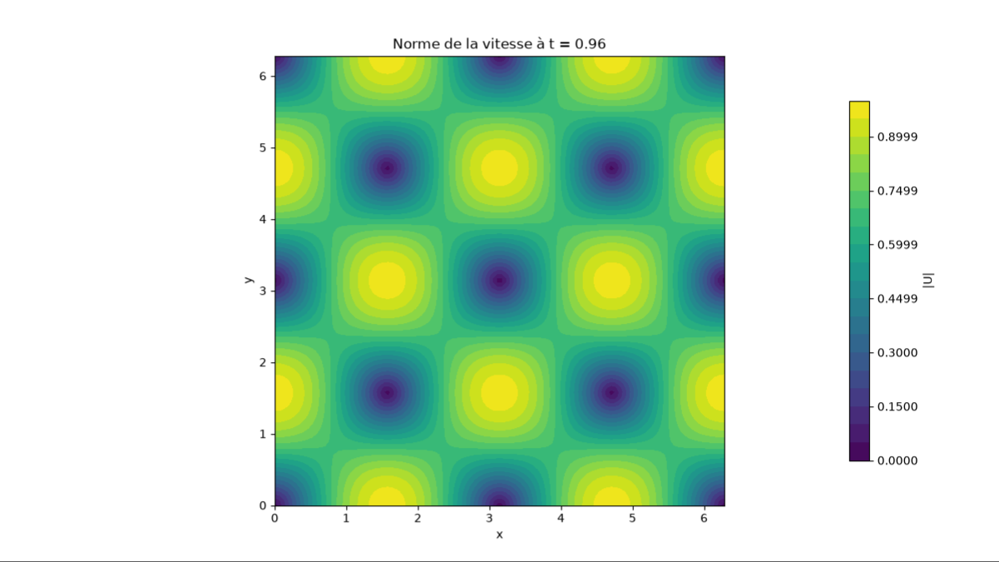
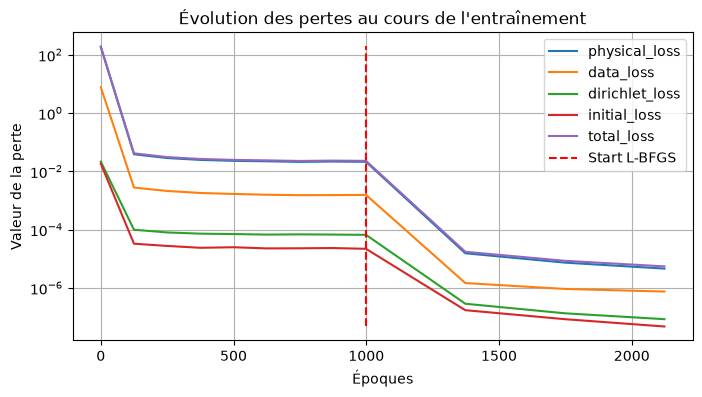
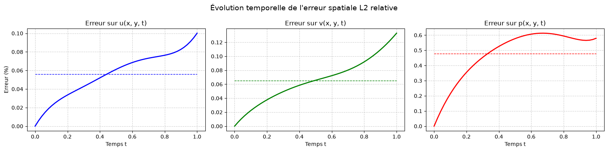

::: {.text-center}
{width="70%"}
:::

## Introduction
The idea behind this project is to solve an **inverse problem** on the Taylor-Green vortex, a classic 2D unsteady flow, and to recover its viscosity from a few measurements by using a Physics-Informed Neural Network (PINN).
My goal was to understand how to inject physics directly into the training of a network, and how to make it work in practice with PyTorch on a GPU.

## The Taylor-Green Vortex
The Taylor-Green vortex is an array of counter-rotating eddies that slowly fades away because of viscosity. 
It is one of the rare unsteady Navier-Stokes flows with a known analytical solution, which makes it the perfect playground: I can generate "measurements" and check precisely whether the network gets the physics right.

## Physics-Informed Neural Networks
A standard neural network learns from data only. A PINN also learns from the **equations**. 
The network takes a point in space and time $(x, y, t)$ and predicts the velocity and the pressure there. Then, thanks to automatic differentiation, I compute the derivatives of its output and measure how badly the Navier-Stokes equations are violated. This violation becomes a term of the loss function, so the network is pushed to be consistent with both the data and the physics.

The trick for the inverse problem is simple: the viscosity is declared as a **trainable parameter**, optimized at the same time as the weights of the network.

## My Implementation

### The Network
A fully-connected network (MLP) with 3 hidden layers of 128 neurons and SiLU activations. SiLU is smooth, which matters a lot here since the equations require second-order derivatives of the output.

### The Loss Function
The total loss is built from several physical ingredients:

*   **Physics:** residuals of the momentum and continuity equations at 10 000 random collocation points.
*   **Data:** mismatch with 3 000 measurements of the flow.
*   **Boundary and initial conditions:** two extra terms constraining the domain edges and the state at $t=0$.
*   **Pressure gauge:** the pressure is only defined up to a constant, so I fixed its mean to remove this ambiguity.

I also experimented with a **hard-constraint reparametrization**, where the output of the network is multiplied by a function that vanishes on the boundaries and at $t=0$. Boundary and initial conditions are then satisfied by construction instead of being learned.

### Training Strategy
Training happens in two phases, a classic recipe for PINNs:

1. **Adam** (1000 epochs, decaying learning rate) to explore the loss landscape and get close to a good solution. The collocation points are resampled every 50 epochs to avoid overfitting a fixed set of points.
2. **L-BFGS** (second-order method) to polish the solution on a fixed set of points.

Everything runs on my RTX 3060 with PyTorch.

### Visualization
*   **Loss curves** for each term, to see which constraint dominates the training.
*   **Relative $L^2$ error over time** for $u$, $v$ and $p$ against the analytical solution.
*   **Animated velocity magnitude** predicted by the network.

::: {layout-ncol=2}

:::

### Results and Limitations
Starting from a wrong initial guess ($\nu = 0.025$, the true value being $0.01$), the network recovers the viscosity with a **relative error below 1%**. The total loss drops from about $10^2$ to $10^{-5}$, and the L-BFGS phase brings a spectacular gain of three orders of magnitude over Adam alone. The relative $L^2$ error stays under $0.15\%$ for the velocity and around $0.6\%$ for the pressure, which is harder to learn since it is never measured directly.

That said, I want to be honest about the limits of this first version. The hard-constraint reparametrization I used is built on top of the analytical solution, so the recovered viscosity is a strong sanity check of my pipeline rather than a blind test. Next steps would be to build the constraints from the initial condition only, use periodic boundary conditions (the natural setting of this flow), add noise and sparsity to the measurements, and ensure the viscosity stays positive. Then the real challenge: moving on to flows without analytical solution.

## Skills Developed
*   Formulating **inverse problems** and coupling physical models with machine learning.
*   Using **automatic differentiation** (PyTorch autograd) to compute high-order derivatives of a network.
*   Designing and balancing **multi-term loss functions**.
*   Combining **first-order and second-order optimizers** (Adam + L-BFGS).
*   **Validating** a numerical method against an analytical solution, and critically analyzing its limits.
*   Training on GPU and producing clear scientific visualizations with Matplotlib.
